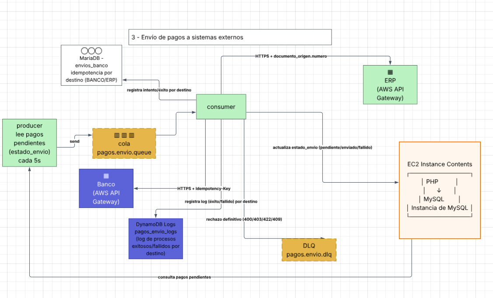

Nombre: Bryan Josue Rivera Hernandez
Carnet: 0905-23-1623
Repositorio: https://github.com/grupo2-stack1-fase2/fase2-feature3-pagos-externos
Modulo asignado: Envío de pagos a sistemas externos por colas

# Feature 3 — Envío de pagos a sistemas externos (AQUORA, Fase 2)

Microservicio que toma los pagos registrados en AQUORA y los notifica a dos sistemas
externos (el banco y el ERP) de forma asíncrona, por colas, con idempotencia por destino
y reintentos controlados para no duplicar pagos ya confirmados.

> Este README documenta primero la arquitectura de la solución integrada completa de la
> Fase 2 (según lo acordado con el equipo), y luego entra en detalle sobre este módulo en
> particular.

---

## 1. Arquitectura de la solución integrada

La solución de Fase 2 está formada por el **monolito heredado de AQUORA** (sin modificar)
más **cuatro features nuevas**, cada una como un servicio independiente que se comunica con
el monolito y/o con sistemas externos:

| Feature | Descripción | Repositorio |
|---|---|---|
| 1. Consulta pública con captcha | Consulta de facturación/estado de cuenta para clientes, protegida con captcha | _repo de otro integrante del equipo_ |
| 2. Chatbot con RAG | Asistente conversacional con recuperación de contexto (RAG) sobre datos de AQUORA | _repo de otro integrante del equipo_ |
| **3. Envío de pagos a sistemas externos por colas** | **Este repositorio.** Notifica cada pago al banco y al ERP vía colas, con idempotencia por destino | `fase2-feature3-pagos-externos` (este repo) |
| 4. Replicación asíncrona a NoSQL/SQL | Replica cambios de AQUORA hacia una base de datos destino | _repo de otro integrante del equipo_ |

El monolito (CodeIgniter 3 / Laravel, según el componente) sigue siendo la única fuente de
verdad para los datos de clientes, lecturas, tarifas y pagos — **no se modificó su código**.
Cada feature nueva lee o escribe sobre la misma base de datos (`oficina_agua_db`) o expone su
propia API, según corresponda, pero nunca reemplaza al monolito.

### Diagrama de arquitectura



> **Nota de transparencia:** los bloques de las Features 1, 2 y 4 (marcados en el diagrama
> con borde punteado rojo) se dibujaron de forma genérica a partir de la descripción del
> enunciado de Fase 2, porque este módulo no tuvo acceso directo al código de esos
> repositorios al momento de escribir esta documentación. El bloque de la **Feature 3**
> (este repo), en cambio, sí refleja los componentes reales del código fuente. Si estos
> otros módulos cambiaron su diseño, actualiza esa parte del diagrama antes de la entrega.

Componentes que sí están confirmados contra el código de este repositorio:

- **`PagoProducer`**: tarea programada (cada 5 segundos) que revisa en la tabla `pagos` los
  registros con `estado_envio = 'pendiente'` y los publica en la cola.
- **RabbitMQ** (`pagos.envio.queue`): cola de mensajes entre el productor y el consumidor,
  con una **Dead Letter Queue** (`pagos.envio.dlq`) para los pagos que el banco rechaza de
  forma definitiva.
- **`PagoConsumer`**: orquesta el envío — revisa, **por cada destino** (banco y ERP), si el
  pago ya fue resuelto para ese destino, llama a la API correspondiente, y decide si marcar
  éxito, reintentar, o mandar a la DLQ. El pago solo se marca `enviado` cuando **ambos**
  destinos confirman éxito.
- **`BankPaymentMapper` + `ClienteInfoRepository`**: arman el request que espera el banco con
  datos reales de AQUORA (nombre del cliente, monto en centavos, fecha, canal de pago).
- **`BankIntegrationService` + `BankFeignClient`**: cliente HTTP real (Spring Cloud OpenFeign),
  generado a partir del contrato OpenAPI oficial del banco, que clasifica cada respuesta según
  el contrato (éxito / reintentable / rechazo definitivo).
- **`ErpPaymentMapper`**: arma el request que espera el ERP (campos en español/snake_case,
  monto como texto con 2 decimales, desglose `detalle[]` por rubro). AQUORA no desglosa el
  pago por rubro, así que se manda una sola línea con `rubro = AGUA_POTABLE` por el monto
  completo (ver decisión técnica en la sección 2.3).
- **`ErpIntegrationService` + `ErpFeignClient`**: cliente HTTP real, generado a partir del
  contrato OpenAPI oficial del ERP, con la misma lógica de clasificación que el banco pero
  adaptada a los códigos de error propios del ERP (`DOCUMENTO_DUPLICADO`,
  `DOCUMENTO_REUTILIZADO`, etc.).
- **Tabla `envios_banco`**: registro de idempotencia por (pago, destino) — una fila por cada
  combinación `(pago, BANCO)` y `(pago, ERP)`, evita reenviar un pago que ya fue confirmado
  por ese destino.
- **APIs externas del banco y del ERP**: ambas expuestas por AWS API Gateway (según el
  contrato oficial entregado por el docente), consumidas por HTTPS con autenticación
  `x-api-key` y una llave de idempotencia estable por pago (header en el banco, campo del
  body en el ERP).
- **`PagoLogDynamoService` + tabla DynamoDB `pagos_envio_logs`**: registra en AWS DynamoDB un
  log de cada intento de envío (éxito o fallo) por pago y por destino — `pagoId`, `timestamp`,
  `destino`, `resultado`, `httpStatus`, `codigoError` e `idExterno` (recibo/comprobante). Es un
  log aditivo, independiente de la tabla `envios_banco` (que sigue siendo la única fuente de
  verdad para la idempotencia): si la escritura en DynamoDB falla, se registra una advertencia
  en el log de la aplicación pero **nunca bloquea ni revierte** el procesamiento del pago.

### Cómo se ejecuta la solución

Este repositorio levanta su propia infraestructura con Docker Compose:

```bash
docker compose up -d
```

Esto levanta **RabbitMQ** (puertos `5672` para la app y `15672` para el panel de
administración, usuario/contraseña `guest`/`guest`). La base de datos de AQUORA
(`oficina_agua_db`, MariaDB/MySQL) se asume que ya existe de forma local (la misma que usa
el monolito) — este microservicio no la crea ni la administra, solo le agrega columnas
nuevas mediante los scripts de `sql/`.

> La ejecución del monolito y de las otras tres features sigue el procedimiento descrito en
> sus propios repositorios; no se documenta aquí porque este módulo no tiene control sobre
> ellos.

---

## 2. Mi módulo: Envío de pagos a sistemas externos por colas

### 2.1 Funcionalidad y objetivo

AQUORA necesita que cada pago que un cliente hace por el servicio de agua quede también
reflejado en el **banco** con el que opera la oficina y en su **ERP** (sistema contable
interno), sin intervención manual. El problema de negocio real que resuelve este módulo es
evitar que, si la comunicación con alguno de esos dos sistemas falla a medias (timeout,
caída de red), el pago se registre dos veces en el destino que falló — algo que un reintento
ingenuo causaría fácilmente.

Este microservicio:

1. Detecta pagos pendientes de notificar en la base de datos de AQUORA.
2. Los encola de forma asíncrona (RabbitMQ) para no bloquear la operación normal del
   monolito.
3. Llama a la API real del banco **y** a la API real del ERP, cada una con su propio cliente
   Feign generado desde su contrato OpenAPI oficial.
4. Garantiza **idempotencia por pago + destino**: antes de reenviar a un destino, revisa si
   ese pago ya fue confirmado específicamente por ese destino (el banco puede haber
   confirmado y el ERP todavía no, o viceversa).
5. Clasifica cada respuesta de cada destino (éxito, reintentable, o rechazo definitivo) y
   actúa en consecuencia — incluyendo una Dead Letter Queue para los rechazos que no tiene
   sentido reintentar. El pago solo se marca `enviado` cuando **ambos** destinos confirman.

### 2.2 Integración y responsabilidades

- **El monolito de AQUORA no se modifica.** Este microservicio solo le agrega 3 columnas de
  control (`estado_envio`, `fecha_envio`, `intentos_envio`) a la tabla `pagos` que ya existe,
  vía migración SQL (`sql/agregar_columna_envio.sql`) — nunca toca su lógica ni su código.
- **Se comunica con la base de datos de AQUORA directamente** (no a través de una API del
  monolito), porque así se definió para esta feature: el productor lee pagos pendientes y el
  consumidor actualiza su estado en la misma base compartida.
- **Se comunica con el banco y con el ERP únicamente por HTTPS**, usando clientes Feign
  generados desde los contratos OpenAPI oficiales que entregó el docente — nunca se
  hardcodeó una llamada manual a ninguno de los dos.
- **No expone las API keys** a ningún otro componente: se inyectan solo como variables de
  entorno al arrancar este microservicio (`BANK_API_KEY`, `ERP_API_KEY`), nunca se commitean. Lo mismo
  aplica a las credenciales de AWS (`AWS_ACCESS_KEY_ID`, `AWS_SECRET_ACCESS_KEY`,
  `AWS_REGION`) usadas por el cliente de DynamoDB: se resuelven en tiempo de ejecución vía
  `DefaultCredentialsProvider` (variables de entorno), nunca hardcodeadas ni commiteadas.
- **Una tabla de seguimiento separada (`envios_banco`) en vez de sobrecargar `pagos`**: se
  decidió así para poder registrar un intento por cada destino (banco y ERP) sin mezclar esa
  información de control con los datos propios del pago.

### 2.3 Decisión técnica relevante

**Idempotencia por `(pago, destino)` en vez de solo por pago, usando una restricción
`UNIQUE` en base de datos en lugar de solo lógica en el código.**

Un mismo pago debe notificarse a dos sistemas externos independientes (banco y, a futuro,
ERP), y cada uno puede confirmar en momentos distintos. Si la idempotencia se controlara solo
por `pago_id`, confirmar en el banco bloquearía incorrectamente el envío al ERP (o viceversa).
Por eso la tabla `envios_banco` tiene una fila por cada combinación de pago y destino, con una
restricción `UNIQUE (pago_id, banco)` a nivel de base de datos:

```sql
UNIQUE KEY uq_envios_pago_banco (pago_id, banco)
```

Se eligió reforzar esto con una restricción de base de datos (no solo con un `if` en Java) por
una razón concreta: si en el futuro hay más de una instancia de este microservicio corriendo
al mismo tiempo (escalamiento horizontal), dos instancias podrían leer "no existe fila
todavía" al mismo tiempo y ambas intentar insertar — la restricción `UNIQUE` evita ese caso
límite de forma garantizada, mientras que una validación solo en memoria no lo evitaría.

La alternativa considerada (una sola tabla con una columna `destino` compartida por todos los
pagos pendientes, sin esa restricción) se descartó porque no ofrecía ninguna garantía real
contra el envío duplicado en ese escenario de concurrencia.

Adicionalmente, la `Idempotency-Key` que se envía al banco (header) y el
`documento_origen.numero` que se envía al ERP (campo del body — el ERP no usa header para
esto) se derivan **siempre del mismo esquema** a partir del `id` del pago (`EQA-000020`),
nunca de un valor aleatorio. Así, aunque el mensaje se reintente varias veces, cada sistema
externo siempre ve la misma clave para el mismo pago y puede detectar duplicados de su lado
también (`409 DUPLICATE_PAYMENT` en el banco, `409 DOCUMENTO_DUPLICADO` en el ERP).

**Una sola línea de `detalle[]` para el ERP, en vez de desglosar por rubro.**

El contrato del ERP exige que cada pago venga con un desglose `detalle[]` (una línea por
`rubro`: agua potable, reconexión, mora, etc.) cuya suma debe calzar exactamente con `total`.
La tabla `pagos` de AQUORA, sin embargo, solo guarda un monto total por pago — el monolito no
registra ese desglose por rubro. La alternativa habría sido inventar una regla de negocio
para "adivinar" cómo repartir el monto entre rubros, pero eso introduciría datos que AQUORA
nunca tuvo y que el equipo no tiene forma de validar contra la fuente real. Por eso se optó
por la opción más honesta con los datos disponibles: una sola línea con
`rubro = AGUA_POTABLE` por el monto completo del pago. Esto cumple el contrato (la suma de
`detalle[]` sigue siendo igual a `total`) sin fabricar información que no existe en AQUORA.

### 2.4 Instrucciones para probar el módulo

**Requisitos previos:** JDK 21+ instalado (el proyecto compila a bytecode Java 21 vía `<java.version>21</java.version>` en el `pom.xml` — se probó corriendo tanto con JDK 21 como con JDK 25 instalado; **ojo:** compilar a bytecode de Java 25 rompe la lectura de anotaciones de Spring/Feign en esta versión de Spring Boot, así que no se recomienda subir ese valor), Maven 3.9+, Docker (para RabbitMQ), y una base de datos
MariaDB/MySQL local con el esquema de AQUORA ya restaurado (`oficina_agua_db`).

**1. Preparar la base de datos** — ejecutar, en este orden, contra `oficina_agua_db`:

```sql
-- Si la tabla de control de pagos aun no existe:
-- sql/agregar_columna_envio.sql
-- sql/crear_envios_banco.sql
-- sql/alterar_envios_banco_idempotencia.sql
```

**2. Levantar RabbitMQ:**

```bash
docker compose up -d
```

Panel de administración: http://localhost:15672 (usuario/contraseña `guest`/`guest`).

**3. Definir las variables de entorno del banco y del ERP** (nunca se exponen credenciales
reales aquí en el repositorio — usa las que entregó el docente el 8/10 junto con los
contratos OpenAPI):

```bash
export BANK_BASE_URL="https://<api-id>.execute-api.us-east-1.amazonaws.com/prod"
export BANK_API_KEY="<api-key-real-del-banco>"
export ERP_BASE_URL="https://<api-id>.execute-api.us-east-1.amazonaws.com/prod"
export ERP_API_KEY="<api-key-real-del-erp>"
export TEAM_CODE="EQUIPO_A"
export AWS_ACCESS_KEY_ID="<access-key-del-usuario-IAM-pagos-externos-dynamodb>"
export AWS_SECRET_ACCESS_KEY="<secret-key-correspondiente>"
export AWS_REGION="us-east-2"
```

> La tabla `pagos_envio_logs` debe existir previamente en DynamoDB (región `us-east-2`),
> con `pagoId` (Number) como partition key y `timestamp` (String) como sort key. El usuario
> IAM necesita el permiso `AmazonDynamoDBFullAccess` (o al menos `PutItem` sobre esa tabla).

**4. Arrancar la aplicación** (en la misma terminal donde se definieron esas variables):

```bash
mvn spring-boot:run
```

Confirmar en el log la línea `Started PagosExternosApplication in X seconds`, sin errores de
conexión a MariaDB ni a RabbitMQ.

**5. Flujo de prueba:**

- Insertar (o marcar) un pago existente con `estado_envio = 'pendiente'` en la tabla `pagos`.
- Esperar hasta 5 segundos, o disparar la revisión manualmente:
  `POST http://localhost:8083/api/pagos-externos/procesar`
- Ver el estado de todos los pagos: `GET http://localhost:8083/api/pagos-externos/estado`
- Ver solo los pendientes/fallidos: `GET http://localhost:8083/api/pagos-externos/estado/pendiente`
- Documentación interactiva de estos endpoints: Swagger UI en
  http://localhost:8083/swagger-ui.html
- También existe una colección de Postman lista para importar en `postman/pagos-externos.postman_collection.json`.

**Resultado esperado:** el pago pasa de `pendiente` → `en_cola` → `enviado` solo cuando
**tanto el banco como el ERP** responden `201` (o su equivalente de "ya estaba entregado":
`409 DUPLICATE_PAYMENT` en el banco, `409 DOCUMENTO_DUPLICADO` en el ERP). Si cualquiera de
los dos rechaza el pago de forma definitiva (por ejemplo `400`/`422`), o agota los reintentos
ante fallos transitorios, el pago queda `fallido`. En la tabla `envios_banco` debe quedar
**una fila por cada destino** para ese `pago_id` (`banco = 'BANCO'` y `banco = 'ERP'`), cada
una con su propio `estado`, `intentos`, y (si tuvo éxito) el comprobante real devuelto por
ese sistema (`receipt_id` del banco, número de comprobante del ERP).

> La integración con el banco y con el ERP ya se verificó en vivo contra sus APIs reales: un
> pago reenviado recibió `409` de ambos sistemas (el banco con `DUPLICATE_PAYMENT`, el ERP con
> su equivalente), clasificado correctamente como éxito, con `envios_banco` quedando en
> `exitoso` para `BANCO` y `ERP` (con su `receipt_id`/comprobante real) y el pago pasando a
> `enviado`. El log de cada intento (éxito y reintentos previos) también quedó registrado en
> DynamoDB (`pagos_envio_logs`), confirmando el flujo completo de punta a punta.

### 2.5 Pendientes conocidos

- `payer.taxId` (banco) no se envía porque la tabla `clientes` de AQUORA no tiene columna de
  NIT — es un campo opcional en el contrato del banco, así que no bloquea el envío. Lo mismo
  aplica a `contribuyente.nit` en el ERP.
- El campo `forma_pago` del ERP (y `channel` del banco) no tienen un valor exacto para el
  método de pago `"deposito"` de AQUORA — se mapea a `TRANSFERENCIA`/`CARD` como la opción
  más cercana
- Queda un archivo legado `BancoSimulado.java` sin usar, de la primera versión de este
  módulo (antes de conectar con el banco real); no se elimina en esta entrega para no
  arriesgar el historial de commits, pero ya no es parte del flujo activo.
